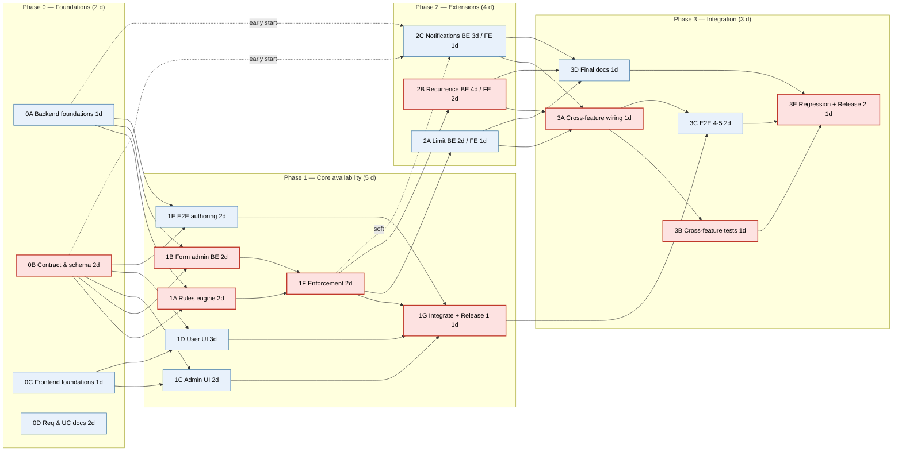
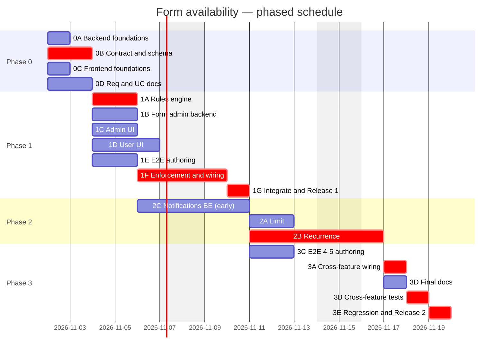

# Implementation Plan — Form Availability (Closing Dates, Manual Close, Limits, Recurrence, Notifications)

Related: [ImpactAnalysis-FormAvailabilityWindow.md](ImpactAnalysis-FormAvailabilityWindow.md), [RequirementsSpecification.md](RequirementsSpecification.md), [TechnicalSpecification.md](TechnicalSpecification.md), [UseCases.md](UseCases.md)

## 1. Customer Answers (baseline)

| # | Topic | Customer decision |
|---|-------|-------------------|
| 1 | Start / end | Automatic **closing date** is enough |
| 2 | Granularity | **Date only**; form stays open **until end of that day** |
| 3 | Editing after close | Submissions are **locked** |
| 4 | Late submit | **10-minute grace period** |
| 5 | Manual control | **Yes**: "Close now" / "Reopen" for Admins |
| 6 | Visibility | Closed forms **shown with a label**, not hidden |
| 7 | Admin exceptions | **Yes**: Admins can submit and edit on closed forms |
| 8 | Time zone | **Finnish time only** (`Europe/Helsinki`) |
| 9 | Existing forms | Admins set dates themselves; **no data migration** |
| 10 | Closed message | **Standard message** |
| 11 | Related features | **Include** email notifications, maximum submissions, and recurring forms |

## 2. Design Decisions Summary

### 2.1 Core rules

| ID | Decision | Rationale |
|----|----------|-----------|
| D1 | All dates are stored as `DATE` (calendar days), interpreted in **`Europe/Helsinki`**. The zone is set in application config (`app.forms.time-zone`), not taken from the browser | Customer answers 2 and 8. Date-only values avoid ambiguous timestamps |
| D2 | **Deadline** = start of the day *after* `closes_on`, in Helsinki time. Example: `closes_on = 2026-10-31` → deadline `2026-11-01T00:00 Europe/Helsinki` | Customer answer 2. `ZonedDateTime` handles daylight-saving changes correctly |
| D3 | **Grace period** = 10 minutes (`app.forms.grace-period=PT10M`, configurable). The backend accepts submissions and edits while `now < closeInstant + grace`. The UI shows the form as closed from `closeInstant` | Customer answer 4. The UI never invites new users into the grace window; the grace only rescues users who were already filling in the form |
| D4 | The grace period applies to the **closing date** and to **manual close**. It does **not** apply to the submission limit | Users mid-form shouldn't lose their work. A limit is a hard capacity |
| D5 | **Manual close** is stored as a timestamp (`closed_at`), not a boolean. "Reopen" clears it. A manual close overrides dates and recurrence until an Admin reopens the form | The timestamp gives the grace start, audit info, and a key for sending the notification only once |
| D6 | **Reopen** only clears the manual close. If the closing date has already passed, the UI tells the Admin to change or clear the date | Keeps one clear meaning per control |
| D7 | Admins (`ROLE_ADMIN`) **skip all availability checks**: closing date, manual close, limit, and edit lock. Their submissions still count toward the limit | Customer answer 7 |
| D8 | **Edit lock:** a User may edit their own submission only while the form accepts submissions. For recurring forms, the submission must also belong to the **current open period** | Customer answer 3, extended consistently to recurrence |
| D9 | Closed, not-yet-open, and full forms **stay in the list** with a status label. A direct URL to a closed form shows the standard message instead of the form | Customer answers 6 and 10 |
| D10 | The **backend decides** the status. It returns a computed `availability` object, and the frontend only displays it | The client clock can't be trusted, and the backend is the place the rules are enforced (Req 4.3) |
| D11 | Time-dependent code uses an injected `java.time.Clock` | Deterministic tests |

### 2.2 Related features (customer answer 11)

| ID | Decision | Assumption to confirm (section 9) |
|----|----------|-----------------------------------|
| D12 | **Maximum submissions:** optional `max_submissions` per form, counting **all** submissions (Users and Admins) in the current period. When reached, the status is `FULL` for Users. Concurrent submissions are serialised with a row lock on the form | The limit is a total, not per user. For recurring forms it resets every period |
| D13 | **Recurring forms:** need `opens_on`, `closes_on`, and a recurrence rule (`WEEKLY`, `MONTHLY`, or `YEARLY`, every *n*). Each period is the first open–close pair shifted by *n* × the frequency, using `LocalDate.plusWeeks/Months/Years`, so 31 Jan + 1 month = 28/29 Feb. A period must be shorter than the repeat interval. Between periods the status is `SCHEDULED`, labelled "Opens 1 Dec" | The customer said no start date was needed, but recurrence can't work without one. `opens_on` is therefore also offered as an optional field for non-recurring forms (zero extra cost) |
| D14 | **Email notifications:** sent when a form **opens** (a recurring period starts) and when it **closes** (deadline + grace passed, manual close, or limit reached). Recipients are a **per-form list of email addresses** entered by the Admin. Delivery uses `spring-boot-starter-mail` over SMTP. A `@Scheduled` job runs every minute. A log table with a unique key ensures each event is sent once | The recipients are Admins/form owners, not every user. Emails are in English only, because the backend has no i18n (Tech 9.1) |
| D15 | Precedence when computing status: **manual close → closing date (+ recurrence) → submission limit → open** | The first rule that applies sets the status |

### 2.3 Technical choices

| ID | Decision |
|----|----------|
| T1 | Keep Hibernate `ddl-auto: update` (current architecture). All new columns are nullable, so the schema update is automatic and safe. Invariants are enforced in the service layer and with JPA `@Table(uniqueConstraints)`. Introducing Flyway is listed as separate technical debt |
| T2 | Set `spring.jpa.properties.hibernate.jdbc.time_zone=UTC` and store new instants as `TIMESTAMP WITH TIME ZONE` (`Instant`). Existing `submitted_at` values are read as UTC |
| T3 | Phased delivery in four phases with parallel tracks (section 7). **Release 1** (end of Phase 1, the core customer problem) ships before limits, recurrence, and email are finished |

### 2.4 Status model

```
                 ┌──────────── manual close ────────────┐
                 ▼                                      │
 SCHEDULED ──(opens_on)──▶ OPEN ──(deadline+grace)──▶ CLOSED
     ▲                      │  ▲                        │
     │                      │  └──── reopen / admin ────┘
     │             (limit reached)     changes dates
     │                      ▼
     │                    FULL
     └──── next recurrence period (recurring forms only) ◀── CLOSED / FULL
```

`status` ∈ `OPEN` | `CLOSED` | `SCHEDULED` | `FULL`, plus `closeReason` ∈ `DEADLINE` | `MANUAL` | `null`.

## 3. Database Changes

### 3.1 `form` table — new nullable columns

```sql
ALTER TABLE form ADD COLUMN opens_on              DATE;          -- optional; required when recurring
ALTER TABLE form ADD COLUMN closes_on             DATE;          -- last day open (inclusive)
ALTER TABLE form ADD COLUMN closed_at             TIMESTAMP WITH TIME ZONE; -- manual close
ALTER TABLE form ADD COLUMN closed_by             VARCHAR(255);
ALTER TABLE form ADD COLUMN max_submissions       INTEGER;       -- > 0
ALTER TABLE form ADD COLUMN recurrence_frequency  VARCHAR(16);   -- WEEKLY | MONTHLY | YEARLY
ALTER TABLE form ADD COLUMN recurrence_interval   INTEGER;       -- >= 1, default 1 when frequency set
ALTER TABLE form ADD COLUMN notification_emails   JSONB;         -- ["owner@example.fi", ...]
```

Hibernate generates these columns from the entity (T1). The SQL above documents the target schema for `TechnicalSpecification.md`.

### 3.2 New table `form_notification_log`

```sql
CREATE TABLE form_notification_log (
    id           BIGSERIAL PRIMARY KEY,
    form_key     VARCHAR(255) NOT NULL,
    event_type   VARCHAR(16)  NOT NULL,   -- OPENED | CLOSED
    event_key    VARCHAR(64)  NOT NULL,   -- period start date, or closed_at instant for manual close
    status       VARCHAR(16)  NOT NULL,   -- SENT | FAILED
    attempts     INTEGER      NOT NULL DEFAULT 0,
    last_attempt TIMESTAMP WITH TIME ZONE,
    UNIQUE (form_key, event_type, event_key)
);
```

### 3.3 Indexes

- `form_data (form_key, submitted_at)`: used to count submissions in the current period (limit check).

### 3.4 Existing data

No migration is needed. All existing forms get `NULL` in the new columns, which means always open, no limit, and no notifications (customer answer 9).

## 4. Backend Changes

### 4.1 Configuration

| File | Change |
|------|--------|
| `application.yaml` | `app.forms.time-zone: Europe/Helsinki`, `app.forms.grace-period: PT10M`, `app.forms.notification-poll: PT1M`, `spring.mail.*` (SMTP via env vars), `hibernate.jdbc.time_zone: UTC` |
| `application-dev.yaml` / `-test.yaml` | Local SMTP catcher (e.g. Mailpit) for dev; GreenMail for tests |
| `config/FormAvailabilityProperties.java` (new) | `@ConfigurationProperties("app.forms")`: `ZoneId timeZone`, `Duration gracePeriod`, `Duration notificationPoll` |
| `config/ClockConfig.java` (new) | `@Bean Clock clock()` → `Clock.systemUTC()` |
| `BackendApplication` / config | `@EnableScheduling` |
| `pom.xml` | `spring-boot-starter-mail`; test: `greenmail-junit5` |

### 4.2 Entity, DTO, and mapper

| Component | Change |
|-----------|--------|
| `entity/Form` | New fields from 3.1. `RecurrenceFrequency` enum. `notificationEmails` as a `List<String>` JSON column |
| `entity/FormNotificationLog` (new) + `repository/FormNotificationLogRepository` (new) | Notification idempotency |
| `dto/FormDto` (create/update/get) | `opensOn`, `closesOn` (`LocalDate`, ISO `yyyy-MM-dd`), `maxSubmissions`, `recurrence {frequency, interval}`, `notificationEmails` (**returned to Admins only**), read-only `availability` |
| `dto/FormAvailabilityDto` (new) | `status`, `closeReason`, `closesAt` (Instant), `opensAt` (Instant, next opening), `acceptsSubmissions` (for the current user) |
| `dto/FormSummaryDto` (list `GET /api/forms`) | Add `availability` (status, `closesAt`, `opensAt` only) |
| `dto/FormDataDto` | Add read-only `editable` (for the current user) |
| `mapper/FormMapper` | Map the new fields. `availability` is filled in by the service (the mapper gets it as context) |

### 4.3 Services

**`service/FormAvailabilityService` (new, pure logic, no I/O except the submission count)**

```java
Availability evaluate(Form form, Instant now);               // status for display
boolean acceptsSubmission(Form form, Instant now, boolean isAdmin);   // incl. grace + limit
boolean canEditSubmission(Form form, FormData sub, Instant now, boolean isAdmin);
Optional<Period> currentPeriod(Form form, LocalDate today);  // recurrence
Instant deadline(LocalDate closesOn);                        // closesOn+1 at 00:00 Helsinki
```

Rules:

1. Admin → always accepted.
2. `closed_at != null` → closed. Accepted while `now < closed_at + grace`.
3. Find the period: for a non-recurring form, `[opens_on, closes_on]`; for a recurring form, the latest period with `opens_on' ≤ today`.
4. Before `opens_on` → `SCHEDULED`.
5. `now ≥ deadline` → `CLOSED`. Accepted while `now < deadline + grace`.
6. `max_submissions` set and the count in the current period ≥ limit → `FULL`. Not accepted.
7. Otherwise `OPEN`.

**`service/FormService` (changes)**

- Validation on create/update:
  - `closes_on ≥ opens_on`
  - `max_submissions ≥ 1`
  - recurrence requires both dates, `interval ≥ 1`, and a period shorter than the repeat interval
  - email addresses must be valid, at most 20
  - past `closes_on` is allowed (the form closes immediately); the frontend shows a warning
- `close(formKey, username)`: sets `closed_at = now()`, `closed_by`. Doing it again changes nothing.
- `reopen(formKey)`: clears `closed_at` and `closed_by`.
- List and get return `availability`. `notificationEmails` is removed for non-Admins.

**`service/FormDataService` (changes)**

- `submit(formKey, data, user)`, in one transaction:
  1. `formRepository.findByFormKeyForUpdate(formKey)` with `@Lock(PESSIMISTIC_WRITE)`. This serialises the limit check.
  2. Throw `FormNotAcceptingSubmissionsException(reason)` if `!acceptsSubmission(...)`.
  3. Save.
- `update(id, data, user)`: throw `SubmissionLockedException` if `!canEditSubmission(...)`.
- Responses fill in `editable`.
- Submitting to a form key that no longer exists is unchanged.

**`config/DatabaseInitializer` (change)**

- The JSON form files accept the new optional fields.
- The initializer only **inserts missing forms**. It never overwrites dates or close state that an Admin set at runtime. If the current behaviour differs, change it in track 1B.

### 4.4 Notifications

| Component | Responsibility |
|-----------|----------------|
| `service/FormNotificationScheduler` (new) | `@Scheduled(fixedDelayString = "${app.forms.notification-poll}")`. For each form with `notification_emails`, compute the events due now: `OPENED` (period start passed), `CLOSED` (deadline + grace passed, `closed_at` + grace passed, or became `FULL`). Skip events already `SENT` in the log. Process at most N per tick |
| `service/NotificationService` (new) | Builds and sends the email with `JavaMailSender`. Plain-text English template: form title, event, date, and a link to the form/submissions. Upserts the log row: `SENT`, or `FAILED` with `attempts++`. Retries until 5 attempts, then logs an error |
| Startup | Only past events from the last 24 h are sent, so the first deploy doesn't send a burst of old events |

Assumption: the app runs as **a single instance** (single JAR, Tech 8.3). If it is scaled out later, add ShedLock or similar.

### 4.5 Error handling (`@RestControllerAdvice`)

| Exception | HTTP | Body `code` |
|-----------|------|-------------|
| `FormNotAcceptingSubmissionsException(CLOSED)` | 409 | `FORM_CLOSED` |
| `FormNotAcceptingSubmissionsException(SCHEDULED)` | 409 | `FORM_NOT_YET_OPEN` |
| `FormNotAcceptingSubmissionsException(FULL)` | 409 | `FORM_FULL` |
| `SubmissionLockedException` | 409 | `SUBMISSION_LOCKED` |
| Validation errors (dates, recurrence, emails) | 400 | `VALIDATION_ERROR` + field list |

Standard body: `{ "code": "...", "message": "<English>", "details": {...} }`. The frontend translates by `code`.

### 4.6 Security

- New endpoints `POST /api/forms/{key}/close` and `/reopen` require `ROLE_ADMIN` (add to `SecurityConfig` and `@PreAuthorize`).
- `notificationEmails` is never returned to non-Admins.
- The public `GET /api/forms` (Tech 6.2) only exposes `status`, `closesAt`, and `opensAt`. Fixing the existing public vs authenticated inconsistency (Tech vs UC-03) is out of scope for this change, but it's tracked in section 9.

## 5. API Changes

All changes are additive, so existing clients keep working.

### 5.1 Form definition (POST / PUT / GET `/api/forms/{key}`, GET `/api/forms/all`)

```json
{
  "formKey": "annual-survey",
  "title": "Annual Survey",
  "description": "...",
  "fields": [ ... ],
  "opensOn": "2026-11-01",
  "closesOn": "2026-11-30",
  "maxSubmissions": 500,
  "recurrence": { "frequency": "YEARLY", "interval": 1 },
  "notificationEmails": ["hr@example.fi"],
  "availability": {
    "status": "OPEN",
    "closeReason": null,
    "closesAt": "2026-11-30T22:00:00Z",
    "opensAt": null,
    "acceptsSubmissions": true
  }
}
```

- `availability` is read-only and ignored on input.
- `closesAt` is the deadline instant (end of the closing day in Helsinki time), not deadline + grace.

### 5.2 Form list `GET /api/forms`

```json
[{ "formKey": "contact", "title": "Contact Form",
   "availability": { "status": "CLOSED", "closesAt": "2026-10-31T22:00:00Z", "opensAt": null } }]
```

### 5.3 New endpoints

| Method | Path | Auth | Response |
|--------|------|------|----------|
| POST | `/api/forms/{key}/close` | ROLE_ADMIN | `200` updated form · `404` |
| POST | `/api/forms/{key}/reopen` | ROLE_ADMIN | `200` updated form · `404` |

### 5.4 Submissions

- `POST /api/form-data/{key}` → `409` with `FORM_CLOSED`, `FORM_NOT_YET_OPEN`, or `FORM_FULL` (not returned for Admins).
- `PUT /api/form-data/submission/{id}` → `409 SUBMISSION_LOCKED` (not returned for Admins).
- All submission responses include `"editable": true|false`.

## 6. Frontend Changes

| File | Change |
|------|--------|
| `types/Form.ts` | `FormAvailability`, `AvailabilityStatus`, `Recurrence`. New optional fields on `FormDefinition` and `FormSummary`. `editable` on submission |
| `services/formClient.ts` | `closeForm(key)`, `reopenForm(key)`. Parse the error `code` into a typed `ApiError` |
| `services/http.ts` | Keep the error body (`code`, `details`) on non-2xx responses |
| `utils/dates.ts` (new) | Format dates with `Intl.DateTimeFormat(locale, { timeZone: 'Europe/Helsinki' })`. The zone is a constant shared with the backend config |
| `pages/EditForm.tsx` | New **"Availability"** section: <br>• Closing date (`type="date"`, clearable). Help text: "Open until 23:59 Finnish time on this day" <br>• Opening date (optional; required when repeating) <br>• Repeat: none / weekly / monthly / yearly + "every n" <br>• Maximum submissions (optional number) <br>• Notification emails (add/remove list) <br>Zod rules mirror the backend (4.3). Warning when the closing date is in the past. **Close now / Reopen** buttons with a confirm dialog, shown for existing forms |
| `pages/Forms.tsx` | Status badge per form: "Closes 31.10.", "Closed", "Opens 1.12.", "Full". Closed/scheduled/full forms are visible but **not clickable** for Users. Admins can open every form and see Close/Reopen actions |
| `components/common/FormAvailabilityBadge.tsx` (new) | Shared badge (react-bootstrap `Badge`), colour per status |
| `pages/FormSubmission.tsx` (new submission) | If `!acceptsSubmissions` and not Admin: show the standard message ("This form is no longer accepting responses" / "This form opens on …" / "This form has reached its maximum number of responses"). Admin viewing a non-open form: warning banner "This form is closed to users. You are submitting as an administrator." |
| `pages/FormSubmission.tsx` (edit mode) | If `!editable`: read-only, with the message "Editing is closed for this form" |
| `pages/FormSubmission.tsx` (on submit) | Handle `409` codes: **keep the form data on screen** and show a translated alert |
| `pages/FormSubmissions.tsx`, `pages/SubmissionDetail.tsx` | Hide **Edit** when `editable === false` |
| React Query | Invalidate `['forms']` and `['form', key]` after close/reopen/update. `refetchOnWindowFocus` for form pages |
| `public/locales/en/translation.json` (+ other locales) | New keys: `forms.status.*`, `form.closed.*`, `editForm.availability.*`, `errors.FORM_CLOSED` and the other codes, `common.closeNow`, `common.reopen` |

## 7. Phased Delivery Plan

The work is split into **four phases**. Inside each phase, work runs in **parallel tracks** that separate developers can own. Tracks share a contract (API, TypeScript types, error codes, DB columns) fixed in Phase 0, so frontend and backend don't wait for each other.

Durations are rough **working days for one developer** and are used only to find the critical path.

### 7.1 Enablers for parallel work

These choices are made up front so tracks don't block or conflict with each other:

| ID | Enabler | What it unblocks |
|----|---------|------------------|
| P1 | **Contract first (Phase 0):** all DTO fields, TS types, error codes, and i18n namespaces from sections 4–6 are merged before feature work starts | Frontend tracks build against the contract with a mocked `formClient`, without waiting for the backend |
| P2 | **Schema first (Phase 0):** all new nullable columns and entity fields from section 3 are added at once. Until the owning track is done, the backend returns `400 VALIDATION_ERROR` ("not supported yet") for its fields, and the UI doesn't show them | Removes merge conflicts on `Form`, `FormDto`, and `FormMapper` between tracks |
| P3 | **Rule pipeline:** `FormAvailabilityService` is built in Phase 1 as an ordered list of rules (D15) with a `currentPeriod()` abstraction (non-recurring = one period) | In Phase 2, the limit track *adds a rule* and the recurrence track *replaces the period provider*. They change different code |
| P4 | **Split editor:** `EditForm.tsx` gets an `AvailabilitySection` with one sub-component per feature (`ClosingDateFields`, `LimitField`, `RecurrenceFields`, `NotificationRecipientsField`) | The frontend tracks don't all edit the same file |
| P5 | **Test clock:** a `MutableClock` bean in the `test` profile, plus a test-only endpoint to move it | Backend integration tests and Selenium E2E can simulate deadlines |
| P6 | **i18n namespaces per track:** `forms.status.*`, `form.closed.*`, `editForm.availability.{closing,limit,recurrence,notifications}.*`, `errors.*` | Fewer conflicts in `translation.json` |

### 7.2 Phase overview

| Phase | Goal | Tracks (parallel) | Elapsed (critical path) | Ships |
|-------|------|-------------------|-------------------------|-------|
| **0 Foundations & contract** | Shared basis for all tracks | 0A, 0B, 0C, 0D | 2 d | – (internal) |
| **1 Core availability** | Fix "people submit to old forms" | 1A, 1B, 1C, 1D, 1E → join 1F → 1G | 5 d | **Release 1** |
| **2 Extensions** | Limit, recurrence, notifications | 2A, 2B, 2C (each BE ∥ FE) | 4 d | Each track may ship on its own |
| **3 Integration & hardening** | Cross-feature behaviour, final release | 3A → 3B, ∥ 3C, 3D → 3E | 3 d | **Release 2 (complete)** |

**Total:** about **14 working days elapsed** with 4 developers + 1 QA, compared with about **39 person-days** done one task at a time.

---

### 7.3 Phase 0 — Foundations & contract

**Entry criteria**
- This plan is approved. Customer answers (section 1) are the baseline.
- Follow-up questions (section 9) are sent to the customer. They don't block this phase.

| Track | Owner | Work | Depends on | Est. |
|-------|-------|------|------------|------|
| **0A** Backend foundations | BE-2 | `ClockConfig`, `FormAvailabilityProperties`, `hibernate.jdbc.time_zone=UTC`, standard error body + `@RestControllerAdvice` codes (4.5), `MutableClock` + test-clock endpoint (P5) | – | 1 d |
| **0B** Contract & schema | BE-1 (FE-2 reviews) | All entity fields/columns (section 3, P2), `FormNotificationLog` entity, DTOs + mapper (no logic), "not supported yet" guards, TS types in `types/Form.ts`, error-code enum, TechSpec API draft | – | 2 d |
| **0C** Frontend foundations | FE-1 | `http.ts` keeps error bodies → `ApiError`, `utils/dates.ts` (Helsinki formatting), `AvailabilitySection` shell (P4), i18n namespaces (P6), mocked `formClient` for component tests | – | 1 d |
| **0D** Requirements & use-case docs | QA / analyst | Draft the RequirementsSpecification and UseCases changes from section 10, for all features | – | 2 d |

All four tracks are **independent** and start on day 1. 0A and 0B both follow the error body format already fixed in section 4.5.

**Exit criteria**
- 0A–0C merged. CI green (build, existing tests, lint).
- The contract PR (0B) is approved by one backend and one frontend developer. From now on it changes only through review.
- Existing behaviour is unchanged: all new columns are `NULL`, and existing tests pass.
- Doc drafts (0D) are reviewed.

---

### 7.4 Phase 1 — Core availability (Release 1)

**Entry criteria:** Phase 0 exit criteria met.

| Track | Owner | Work | Depends on | Est. |
|-------|-------|------|------------|------|
| **1A** Availability rules engine | BE-1 | `FormAvailabilityService` as a rule pipeline (P3): deadline, grace, manual close, admin bypass, `canEditSubmission`, `currentPeriod()` for one period. Unit tests: Phase 1 rows of 8.1 | 0A, 0B | 2 d |
| **1B** Form admin backend | BE-2 | Remove the `closes_on` guard + validation, `DatabaseInitializer` (insert-only), `close`/`reopen` service + endpoints, `SecurityConfig`, controller tests for 403/404 | 0A, 0B | 2 d |
| **1C** Admin UI | FE-1 | `ClosingDateFields` (date, help text, past-date warning, Zod), Close now / Reopen buttons + confirm dialog, query invalidation, vitest | 0B, 0C | 2 d |
| **1D** User UI | FE-2 | `FormAvailabilityBadge`, `Forms.tsx` (labels, not clickable for Users), `FormSubmission.tsx` closed/locked views + Admin banner, 409 handling that keeps entered data, hide Edit in `FormSubmissions`/`SubmissionDetail`, vitest | 0B, 0C | 3 d |
| **1E** E2E authoring | QA | Selenium scenarios 1–3 (8.5) using the test clock, test fixtures | 0A, 0B | 2 d |
| **1F** Enforcement & wiring *(join)* | BE-1 | `FormDataService.submit/update` checks, `editable` on submission DTOs, `availability` on form/list DTOs, integration tests (8.3, Phase 1 part) | **1A + 1B** | 2 d |
| **1G** Integrate & release *(join)* | All | Frontend switched from mocks to the real API, E2E 1–3 run, fixes, TechSpec Phase 1 sections, Release 1 deploy | **1C + 1D + 1E + 1F** | 1 d |

**Can run in parallel:** 1A, 1B, 1C, 1D, 1E (five people). **Joins:** 1F needs 1A and 1B; 1G needs everything.

**Slack:** BE-2 is free after 1B (day 4). Use the time to **start 2C early** (see 7.5).

**Exit criteria**
- All Phase 1 rows of 8.1 and the Phase 1 parts of 8.2–8.4 are green. E2E 1–3 pass.
- Coverage ≥ 70 % overall and 100 % branch coverage on `FormAvailabilityService`.
- Guards are still active for limit, recurrence, and notification fields.
- Release 1 is deployed. Admins can set closing dates on existing forms (customer answer 9).
- RequirementsSpecification, UseCases, and TechSpec are updated for Phase 1 scope.

---

### 7.5 Phase 2 — Extensions

**Entry criteria (per track)**
- **2A, 2B:** 1F merged (the rule pipeline and enforcement exist).
- **2C:** 0A + 0B merged. It doesn't need Phase 1 and **may start during Phase 1**. Wiring its CLOSED events to availability needs 1F.
- **Each track:** the customer has answered its follow-up questions from section 9:
  - 2A: questions 3 and 6
  - 2B: questions 4 and 5
  - 2C: questions 1 and 2

  If an answer is missing, the track proceeds on the documented assumption.

| Track | Owner | Backend work | Frontend work (parallel to backend) | Est. |
|-------|-------|--------------|-------------------------------------|------|
| **2A** Submission limit | BE-2 / FE-2 | Remove the guard, add the limit rule to the pipeline, `findByFormKeyForUpdate` (pessimistic lock), count per `currentPeriod()`, index on `form_data(form_key, submitted_at)`, `FORM_FULL`, PostgreSQL concurrency test | `LimitField`, "Full" badge, `FORM_FULL` message | BE 2 d · FE 1 d |
| **2B** Recurring forms | BE-1 / FE-1 | Remove the guard, add the recurrence period provider (replaces the single period), `SCHEDULED` + `opensAt`, validation (period < interval), period-scoped edit lock, month-end/leap-year tests | `RecurrenceFields` + opening date, "Opens …" badge + message | BE 4 d · FE 2 d |
| **2C** Email notifications | BE-2 (early start) / FE-1 | Mail dependency + config, `NotificationService`, `FormNotificationScheduler` with **CLOSED** events (deadline + grace, manual close), idempotency, retry, no backlog burst on startup, GreenMail tests, SMTP deployment docs | `NotificationRecipientsField` | BE 3 d · FE 1 d |

**Can run in parallel:** 2A, 2B, and 2C are independent of each other. Inside each track, backend and frontend run in parallel against the contract.

**Merge order:** 2A and 2B touch the same service in different places (P3). Merge **2A first** (smaller), then rebase 2B on it.

**Exit criteria (per track; each track can ship on its own)**
- The guard is removed. The track's rows in 8.1/8.2 and its integration tests are green.
- The UI field is visible and tested. The i18n keys exist in all locales.
- 2C only: an SMTP account is available in the target environment.

---

### 7.6 Phase 3 — Integration & hardening

**Entry criteria:** 2A, 2B, and 2C merged.

| Track | Owner | Work | Depends on | Est. |
|-------|-------|------|------------|------|
| **3A** Cross-feature wiring | BE-1 | **OPENED** events from recurrence periods (2B × 2C), **CLOSED** event when FULL (2A × 2C), confirm the limit resets each period (2A × 2B) | 2A, 2B, 2C | 1 d |
| **3B** Cross-feature tests | BE-2 | Combined 8.1 cases (recurring + limit + manual close), concurrency on PostgreSQL for a recurring form, notifications through a full recurrence cycle | 3A | 1 d |
| **3C** E2E scenarios 4–5 + notifications | QA | Selenium for limit and recurrence, notification check via the test SMTP. **Authoring can start in Phase 2**; running them needs 3A | 1G (authoring), 3A (run) | 2 d |
| **3D** Final documentation | FE-2 / analyst | TechSpec (scheduler, config, SMTP env vars), UC-13/UC-14, Known Limitations | 2A, 2B, 2C | 1 d |
| **3E** Regression & release *(join)* | All | Full regression, coverage check, Release 2 deploy, customer acceptance demo | 3B, 3C, 3D | 1 d |

**Exit criteria**
- All tests in section 8 are green. Coverage targets are met. All guards are removed.
- Documentation (section 10) is complete.
- Release 2 is deployed. The customer has accepted the demo of all features from answers 1–11.

---

### 7.7 Dependencies between phases

| From | To | Type | Reason |
|------|----|------|--------|
| Phase 0 (0A, 0B) | 1A, 1B, 1E | hard | Clock, config, entity fields, error format |
| Phase 0 (0B, 0C) | 1C, 1D | hard | Contract, TS types, mocked client, editor shell |
| 1A + 1B | 1F | hard | Enforcement uses the rules and the persisted fields |
| 1F | 2A, 2B | hard | Both extend the rule pipeline |
| 0A + 0B | 2C | hard | Mail sending and the log table only need foundations, so **early start is possible** |
| 1F | 2C (event detection) | soft | CLOSED event detection calls `evaluate()` |
| 2A → 2B | merge order | soft | Same service; avoid conflicting changes |
| 2A, 2B, 2C | 3A | hard | Cross-feature wiring |
| 3A | 3B, 3C (run) | hard | Tests need the combined behaviour |

### 7.8 Concurrency map and critical path

The **critical path** (red) is the longest chain of dependent work:

**0B (2 d) → 1A (2 d) → 1F (2 d) → 1G (1 d) → 2B-BE (4 d) → 3A (1 d) → 3B (1 d) → 3E (1 d) = 14 working days**

1B has the same length as 1A, so it's equally critical. A delay in either one delays 1F.



Timeline view (assumes a start on Mon 2 Nov 2026; weekends excluded):



**Float (slack) on tracks that are not on the critical path:**

| Track | Float | Note |
|-------|-------|------|
| 0A, 0C | 1 d | Done before 0B finishes |
| 1C | 2 d | Finishes day 4; 1G starts day 7 |
| 1D | 1 d | The longest frontend task. Watch it if 1D slips more than 1 day |
| 1E | 2 d | |
| 2A | 2 d | BE-2 then helps with 2B tests |
| 2C | Large | Started early in Phase 1 |
| 3C, 3D | 1–3 d | |

**How to shorten the critical path:** split **2B** (4 d) into recurrence calculation and validation (BE-1) and the period-scoped edit lock and limit reset (BE-2, after 2A). This saves about 1–2 days.

### 7.9 Team allocation

| Developer | Phase 0 | Phase 1 | Phase 2 | Phase 3 |
|-----------|---------|---------|---------|---------|
| BE-1 (domain) | 0B | 1A → 1F → 1G | 2B backend | 3A → 3E |
| BE-2 (platform) | 0A | 1B → 2C backend (early start) | 2C backend finish → 2A backend | 3B → 3E |
| FE-1 | 0C | 1C → 1G | 2B frontend, 2C frontend | 3E |
| FE-2 | 0B review | 1D → 1G | 2A frontend | 3D → 3E |
| QA / analyst | 0D | 1E → 1G | 3C authoring | 3C → 3E |

### 7.10 Which tasks are fully independent?

These groups have **no dependencies on each other**, so separate developers can work on them at the same time:

| When | Independent tasks | Shared contract they rely on |
|------|-------------------|------------------------------|
| Day 1 | **0A** Backend foundations ∥ **0B** Contract & schema ∥ **0C** Frontend foundations ∥ **0D** Requirements/UC docs | Sections 3–6 of this plan |
| After Phase 0 | **1A** Rules engine ∥ **1B** Form admin backend ∥ **1C** Admin UI ∥ **1D** User UI ∥ **1E** E2E authoring | 0B contract, mocked client, test clock |
| From day 5 (early) | **2C** Notifications backend, running alongside Phase 1 | Log entity + config from 0A/0B |
| After 1F | **2A** Limit ∥ **2B** Recurrence ∥ **2C** Notifications, and inside each one **backend ∥ frontend** | Rule pipeline (P3), split editor (P4) |
| Phase 3 | **3C** E2E ∥ **3D** Docs, running alongside **3A → 3B** | – |

**These are not parallel; they must wait:**
- **1F** waits for 1A and 1B.
- **1G** and **3E** are joins for the whole team.
- **3A** waits for all Phase 2 tracks.
- **2B** merges after 2A, because both change the same service.

## 8. Testing Plan

### 8.1 Backend unit tests — `FormAvailabilityService` (fixed `Clock`, `@ParameterizedTest`)

| Case | `closes_on` | `now` (Helsinki) | User | Expected status / accepted |
|------|-------------|------------------|------|----------------------------|
| No dates | – | any | User | OPEN / ✔ |
| Before deadline | 2026-10-31 | 31.10. 23:59:59 | User | OPEN / ✔ |
| At deadline | 2026-10-31 | 01.11. 00:00:00 | User | CLOSED / ✔ (grace) |
| End of grace − 1 s | 2026-10-31 | 01.11. 00:09:59 | User | CLOSED / ✔ |
| End of grace | 2026-10-31 | 01.11. 00:10:00 | User | CLOSED / ✘ |
| After grace, Admin | 2026-10-31 | 02.11. 12:00 | Admin | CLOSED / ✔ |
| DST end (UTC+3 → +2) | 2026-10-24 | 25.10. 00:00 local = 24.10. 21:00Z | User | CLOSED from exactly 21:00Z |
| DST start (UTC+2 → +3) | 2027-03-27 | 28.03. 00:00 local = 27.03. 22:00Z | User | CLOSED from exactly 22:00Z |
| Manual close | – | `closed_at` + 9 min | User | CLOSED (MANUAL) / ✔ |
| Manual close | – | `closed_at` + 10 min | User | CLOSED (MANUAL) / ✘ |
| Manual close overrides future date | 2027-01-01 | after `closed_at` + grace | User | CLOSED / ✘ |
| Reopen after close | 2027-01-01 | after reopen | User | OPEN / ✔ |
| Edit own submission, open | 2026-10-31 | 30.10. | User | editable ✔ |
| Edit own submission, closed | 2026-10-31 | 02.11. | User | editable ✘ |
| Edit any submission, closed | 2026-10-31 | 02.11. | Admin | editable ✔ |
| **2A** Limit reached | – | any | User | FULL / ✘ (no grace) |
| **2A** Limit reached, Admin | – | any | Admin | FULL / ✔ |
| **2B** Monthly, 31 Jan–2 Feb | – | 28.02. | User | OPEN (period 28.2.–2.3.) |
| **2B** Yearly from 29 Feb | – | 2027-02-28 | User | period starts 28.2. |
| **2B** Between periods | – | gap day | User | SCHEDULED, `opensAt` = next start |
| **2B** Submission from previous period | – | new period | User | editable ✘ |
| **2B** Limit resets per period | – | new period | User | OPEN |

### 8.2 Backend validation tests (`FormService`)

- `closes_on < opens_on` → 400
- `max_submissions ≤ 0` → 400
- recurrence without dates → 400
- period ≥ interval → 400
- invalid email → 400
- past `closes_on` → accepted
- `notificationEmails` hidden for a User

### 8.3 Backend integration tests (Spring Boot Test; H2 + Testcontainers PostgreSQL)

- Controller: `409` + correct `code` for each reason. Admin bypass. `403` for a User on close/reopen. `editable` flag in responses.
- Persistence: `DATE` and `TIMESTAMPTZ` round-trip on PostgreSQL. JSONB `notification_emails`.
- **Concurrency (PostgreSQL only):** `max_submissions = 1`, 10 parallel submits → exactly 1 succeeds, 9 get `FORM_FULL`.
- `DatabaseInitializer`: new fields parsed. Existing admin-set dates are not overwritten on restart.
- Time travel: a `@Primary MutableClock` test bean, moved forward across the deadline within one test.
- **Notifications (GreenMail):** one `OPENED` and one `CLOSED` email per period. No duplicates across scheduler ticks or after a restart. SMTP failure → `FAILED` row, retried, stops at 5 attempts. No email for forms without recipients. No old-event burst on first startup.

### 8.4 Frontend tests (vitest + Testing Library)

- `EditForm`: Zod rules (date order, positive limit, recurrence requires dates, email format), past-date warning, Close/Reopen confirm + API call.
- `FormAvailabilityBadge`: each status/label, dates in Helsinki time regardless of the test runner's time zone (run with `TZ=America/New_York`).
- `Forms`: non-open forms are not clickable for Users and are clickable for Admins.
- `FormSubmission`: closed message; Admin banner; on `409 FORM_CLOSED` the entered values stay and the alert is shown; edit mode read-only when `editable=false`.
- `FormSubmissions`/`SubmissionDetail`: Edit hidden when not editable.
- i18n: all new keys exist in every locale file (key-parity test).

### 8.5 E2E (Selenium)

1. Admin sets a closing date of yesterday → User sees a "Closed" badge, can't open the form, and can't edit an old submission. Admin can submit and edit.
2. Admin presses Close now → User's open form tab submits successfully within the grace period. After the grace period (simulated clock), the submit is rejected with the data kept.
3. Admin reopens → User can submit again.
4. **2A** The limit of 1 is reached → second User sees "Full".
5. **2B** A recurring form shows "Opens …" between periods.

### 8.6 Coverage and quality

- Keep the > 70 % coverage target (Req 4.4); aim for 100 % branch coverage on `FormAvailabilityService`.
- Google Java Style, ESLint, and Prettier pass in CI.

## 9. Open Follow-up Questions for the Customer

These assumptions came from answer 11 ("include these as well"). They don't block Phase 0 or 1. Each Phase 2 track needs its own answers (see 7.5).

1. **Notification recipients:** who should get the open/close emails? We plan a per-form list of addresses entered by the Admin.
2. **Email language:** is English OK for notification emails, or are Finnish emails needed?
3. **Submission limit:** is the limit a **total** per form (our assumption) or **per person**? Do Admin submissions count toward it?
4. **Recurring schedule:** are weekly, monthly, and yearly repeats enough? Should a manual close stop only the current period or all future ones? Our plan: all future periods until reopened.
5. **Opening date:** recurrence needs an opening date. Is it OK to also offer it as an optional field on normal forms?
6. **Grace period for limits:** we don't apply the 10-minute grace when a form is full (a hard cap). Is that OK?

Internal follow-ups (not for the customer):

- Fix the `GET /api/forms` public vs authenticated inconsistency (Tech 5.3/6.2 vs UC-03).
- Consider introducing Flyway instead of `ddl-auto: update` (technical debt).

## 10. Documentation Updates

| Document | Section | Change |
|----------|---------|--------|
| RequirementsSpecification.md | 3.2 Form Management | Closing/opening date, manual close/reopen, max submissions, recurrence, notification recipients |
| | 3.3 Form Submission | Accepted only while open (+10 min grace); edit lock; Admin exception |
| | 3.4 / 3.5 | Status labels; dates shown in Finnish time |
| | 6 Known Limitations | Remove nothing. Add "Notification emails in English only" |
| UseCases.md | Authorization matrix | Rows: "Submit/edit when form is closed" (User: No, Admin: Yes), "Close/reopen a form" (Admin) |
| | UC-03, UC-04, UC-07, UC-09, UC-10 | Status labels; alternative flows "Form closed / not yet open / full", "Submission locked" |
| | New UC-13, UC-14 | Close/Reopen a form; Receive form notifications |
| TechnicalSpecification.md | 4.1, 5.3, 5.4, 6.2, 7, 8.3 | Schema, DTOs, endpoints, error codes, security rules, `app.forms.*` config, SMTP env vars |
| | New section | Availability rules (D1–D15), time-zone policy, notification scheduler |
